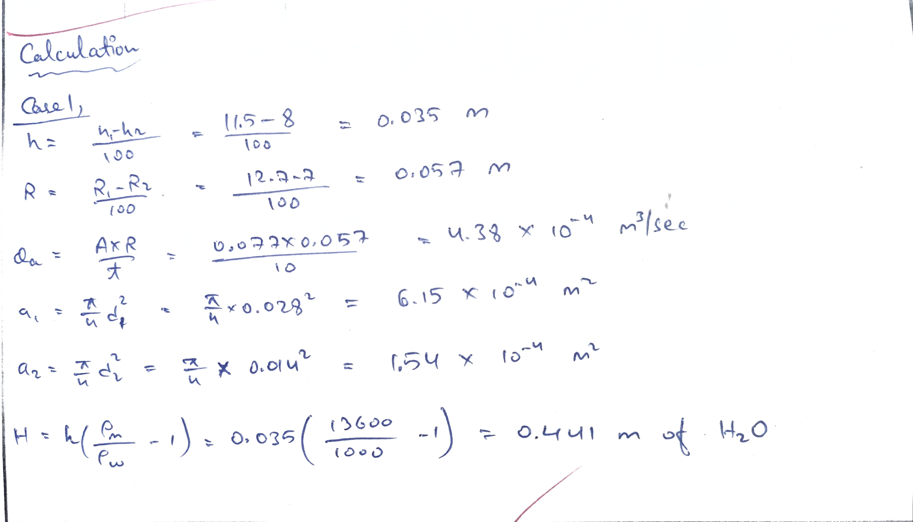
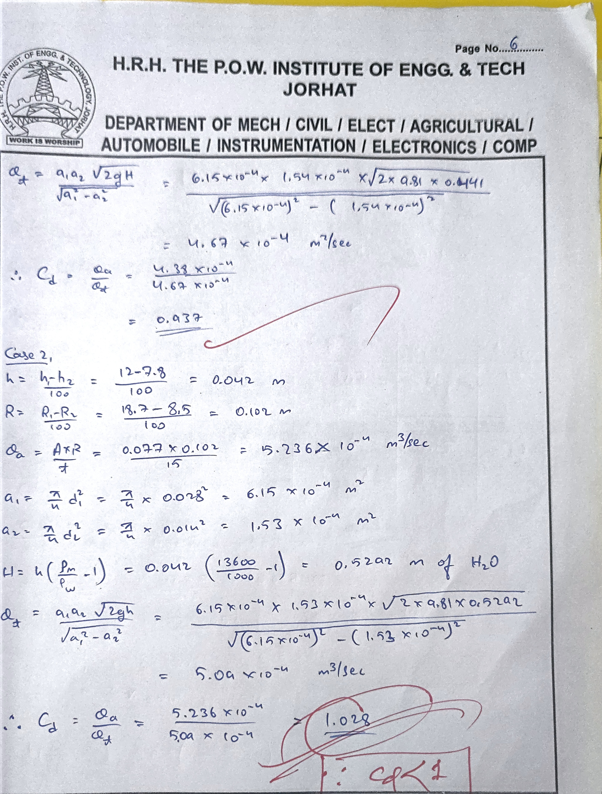
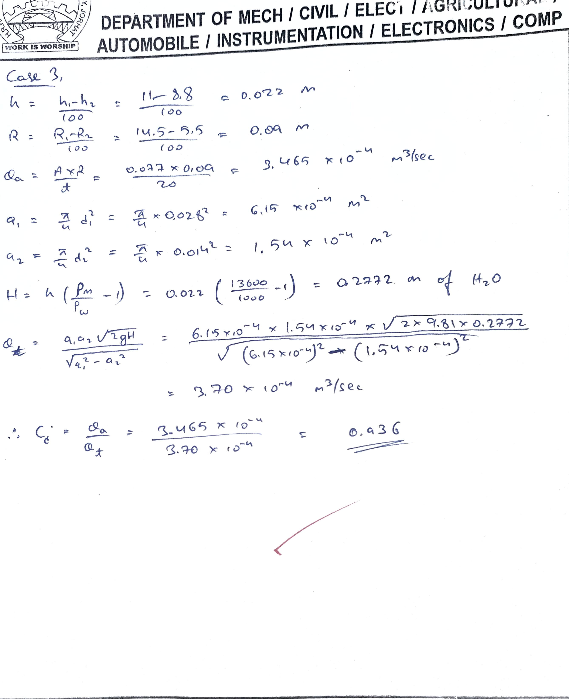
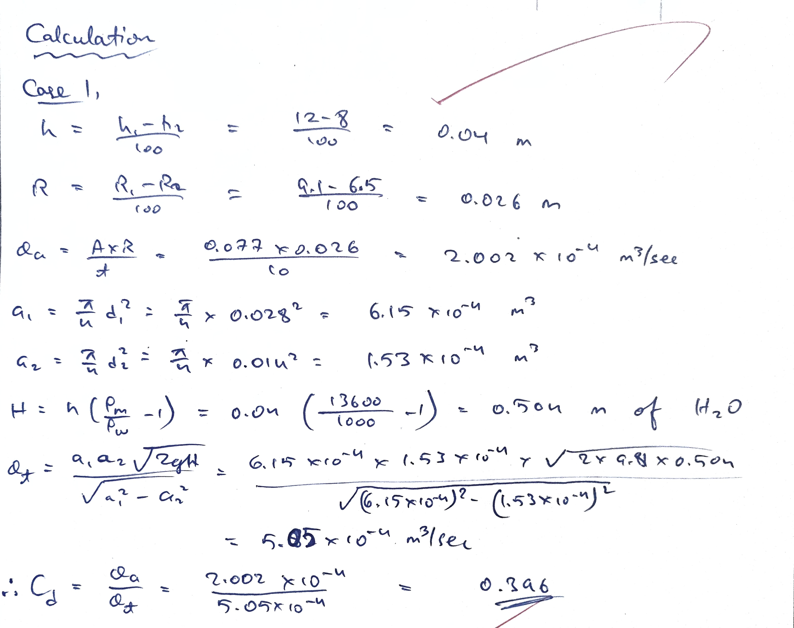
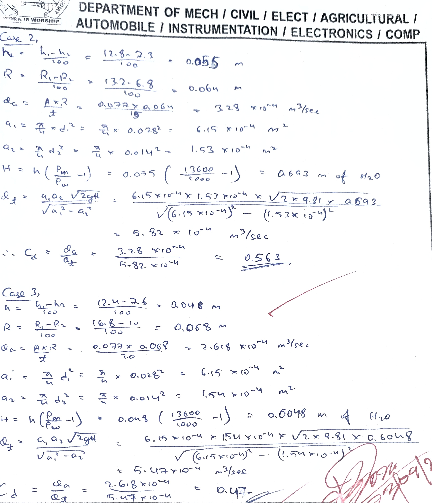
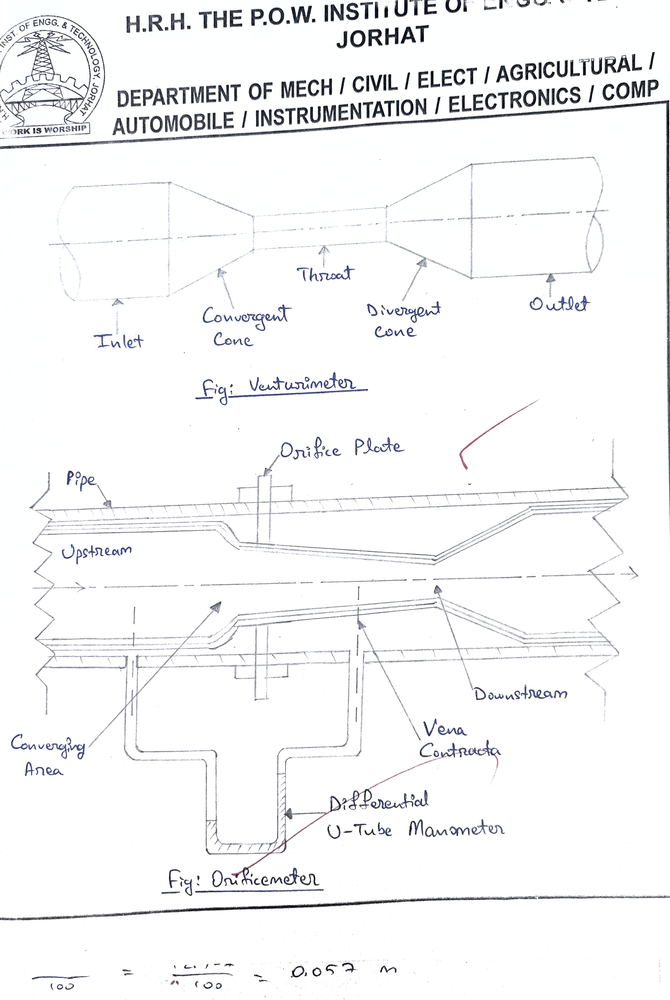

- **Title:** Orificemeter and Venturimeter  
- **Experiment no.:** 01  
- **Aim:** To determine the coefficient of discharge for Orificemeter and Venturimeter.

## Introduction 
If a constriction is placed in a closed channel carrying a stream of fluid, there will be increase in velocity and hence increase in kinetic energy, at the constriction,from an energy balance, as given by Bernoulli's theorem, there must be a corresponding reduction in pressure. Rate of discharge from the constriction can be calculated by knowing this pressure reduction, the area available for flow at the constriction, the density of fluid, and the coefficient of discharge. The last named is defines as the ratio of actual flow to the theoretical flow. 

## Theory 
### Venturimeter 
A venturi consists of: 

1. An inlut section followed by a convergent cone
2. A cylindrical throat 
3. A gradually divergent cone 

The inlet section fo the venturimetr is of the same diameter as of the pipe, which is followed by a convergent cone. THe convergent cone is a short pipe, which tapers from the original size of the pipe to that of the throat of the venturimeter. The throat of the venturimeter is a short parallel side tube having its cross sectional area smaller that that of the pipe. The divergent cone of the venturimeter is gradually diverging pipe with its cross-sectional area increasing from that of the throat to the original size of the pipe. The inlet section and throat of the veneturimeter pressure taps are provided. 

### Orificemeter 
An orificimeter consists of a flat circular plate with a circular holee called orifice, which is concentric with the pipe axis. 

## Description 
The apparatus consists of a venturimeter and an orificemeter, fitted in separate pipe. Both the pipe consists of separate flow control valves and common inlet and outlet. Sump tank with centrifugal pump is provided for water circulation through pipes. The pressure tapings are provided at inlet and throat of venturimeter and inlet and outlet of orificiemeter. The pressure tapings are connected to a differential manometer. Discharge is measured  with the help of measuring tank and stop watch. 

## Experimental Procedure 
### Starting Procedure 
1. Close all the valves provided. 
2. FIll sump tank 3/4 with clean water and no foreign particles are there. 
3. Open bypass valve. 
4. Fill manometer with mercury by opening the valve and PU pipe from the test section connected at the bottom most point of manometer. 
5. Close the valve and connect the PU pipe backk to its place after doing so. 
6. Ensure that ON/OFF switch given in the panel is at OFF position. 
7. Switch ON the main power supply and then switch ON the pump. 
8. Open flow control valve of desired test section (venturimeter or orificemeter).
9. Open the pressure taps of manometer of related test section, very slowly to avoid the blow of water on manometric fluid. 
10. Open the air release valve provided on the manometer, slowly to release the air from the manometer. 
11. When there is no air in the manometer, close the air releases valves. 
12. Adjust the water flow rate in desired section with the help of control valve and bypass valve. 
13. Record the manometer reading. 
14. Measure the flow of water tank, discharged through desired test section, using stop watch and measuring tank. 
15. Repeat steps (12) to (14) for different flow rates of water, operating control valve and bypass valve. 
16. When experiment is over for one desired test section, open the bypass valve fully. THen close the flow control valve of rutting test section and open the contol valve of the desired test section. 

### Closing Procedure 
1. When experiment is over, close the pressure taps of manometer. 
2. Switch OFF pump. 
3. Switch OFF power supply to panel. 
4. Drain the apparatus completely. 

## Observation and Calculation 

### Data, 

- A = 0.077 $m^2$
- g = 9.81 $m/\text{sec}^2$
- $P_m$ = 13600 $kg/m^3$
- $P_w$ = 1000 $kg/m^3$

### For Venturimeter
- $d_1 = 0.028 m$
- $d_2 = 0.014 m$

### For Orificemeter 
- $d_1 = 0.028 m$
- $d_2 + 0.014 m$

## Table for Venturimeter

| S.No. | $h_{1}$ cm | $h_{2}$ cm | $R_{1}$ cm | $R_{2}$ cm | $t$ sec |
| ----- | ---------- | ---------- | ---------- | ---------- | ------- |
| 1     | 11.5       | 8          | 12.7       | 7          | 10      |
| 2     | 12         | 7.8        | 18.7       | 8.5        | 15      |
| 3     | 11         | 8.8        | 14.5       | 5.5        | 20      |

## Calculations 

