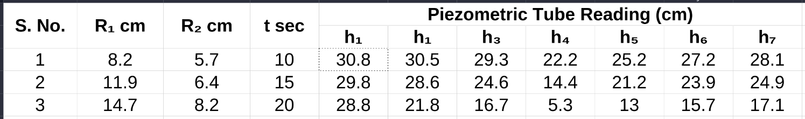
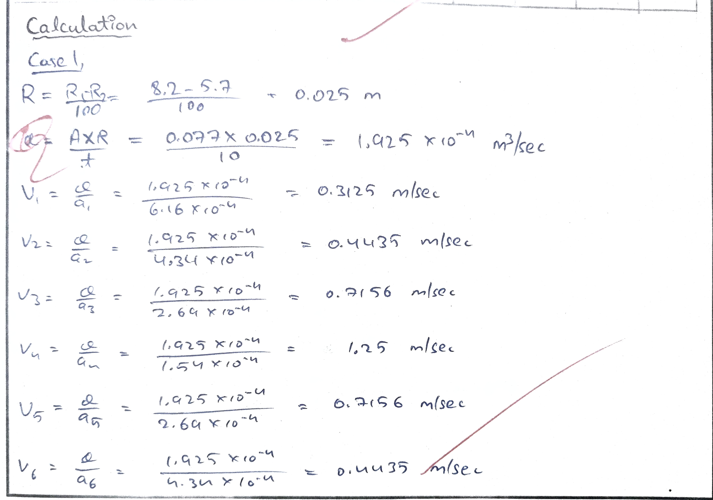
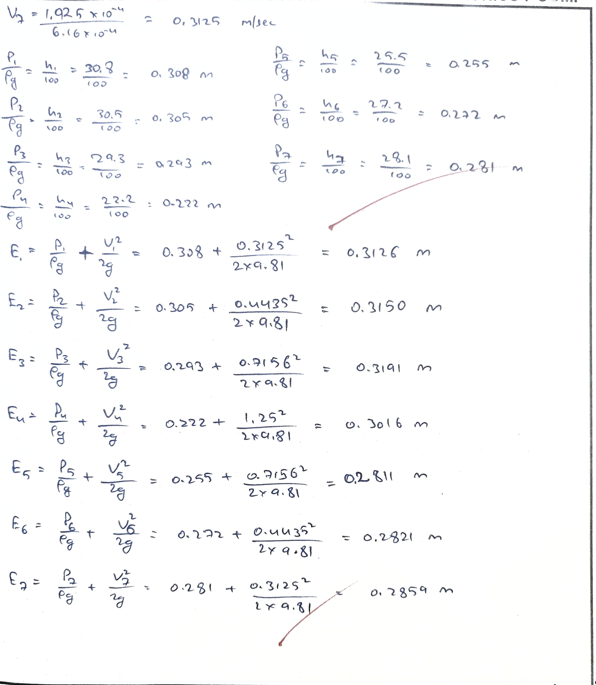
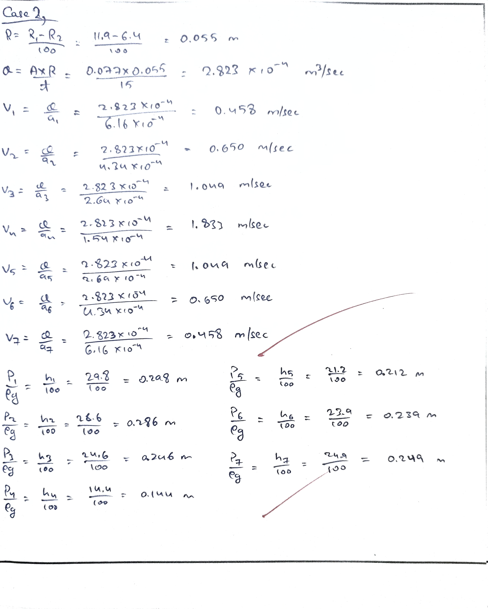
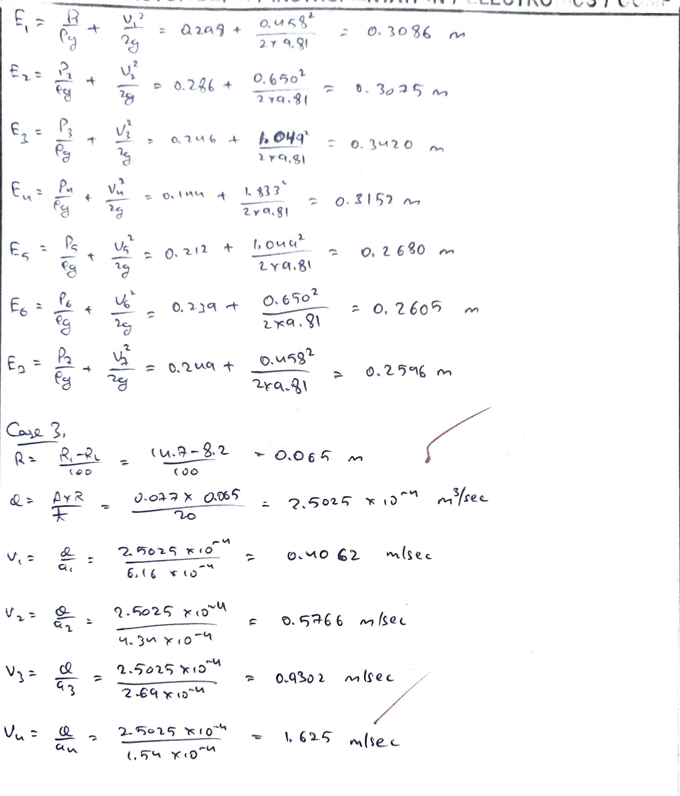
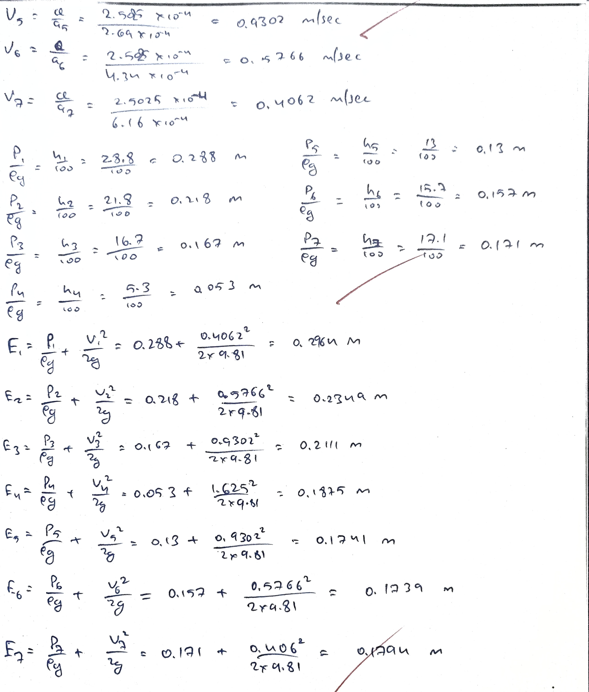
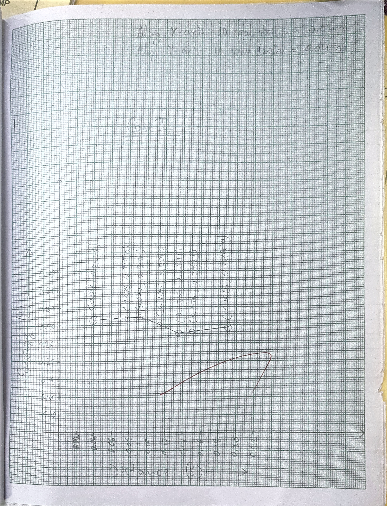
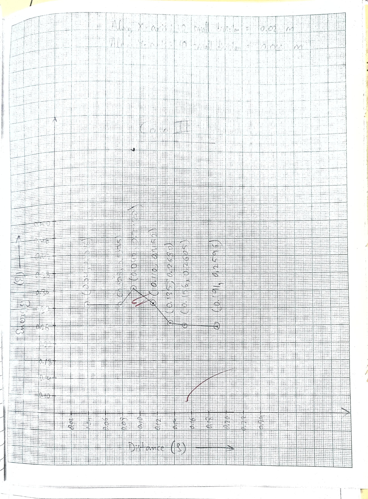
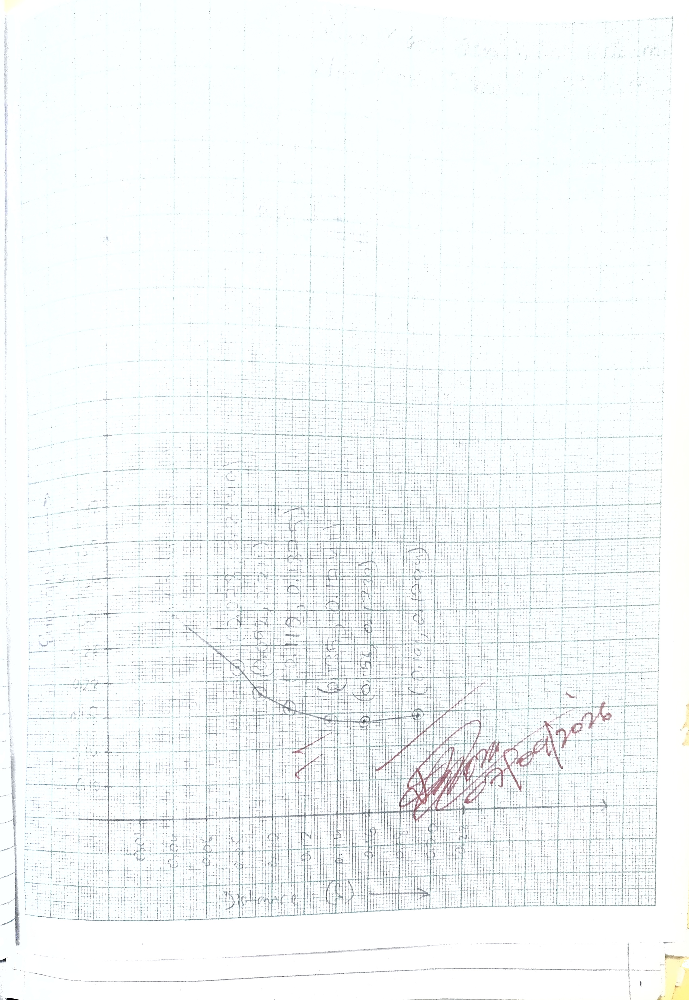

- **Experiment no.:** 02 
- **Title:** Bernoulli's Theorem 
- **Aim:** To calculate the total energy at different points. To plot the graph between total energy and distance. 

## Introduction 
Bernoulli's theorem states that when there's a continuous connection between particles of flowing mass of liquid, the total energy at any section of flow will remain the same provided there is no reduction or addition of energy at any point.

## Theory 
This is the energy equation is based on the law of conservation of energy. This equation states that at two sections of flow field, the total energy remains the same, provided that there is no loss or gain of energy between the two sections. This equation is valid only for steady flow. This equation is expressed as: 

$$
E = \frac{P_1}{\rho g} + \frac{V_1^2}{2g} + Z_1 = \frac{P_2}{\rho g} + \frac{V_2^2}{2g} + Z_2
$$

## Description 
The present experimental set-pu for Bernoulli's theorem is self-contained re–circulating unit. The setup accompanies the sump tank, constant head tank, centrifugal pump for water circulation, measuring tank, etc. Control valve and bypass valve are provided to regulate the flow of water in constant head tank. A conduit, made of perspex, of varying cross section is provided, which is having converging and diverging section. Piezometer tubes are fitted on this test section at specified point. THe inlet of the conduit is connected to constant head tank. Discharge through test section can be measured with the help of measuring tank and stop watch. 

## Utilities Required 
1. Electricity supplied: Single phase, 220 V AC, 50 Hz, 5–15 amp socket with earth connection 
2. Water supply (initial fill)
3. Floor drain required 
4. Floor area required: 1.5 m x 0.75 m 

## Experimental Procedure 
### Starting Procedure 
1. Ensure that all ON/OFF switches given on the panel are at OFF position. 
2. Close all the valves. 
3. Fill sump tank with water. 
4. Open bypass valve given on the water supply line. 
5. Switch ON the main power supply and switch ON the pump. 
6. Partially close bypass valve to allow water to fill in overhead tank. 
7. Wait until overlow occucrs in from overhead tank. 
8. Regulate flow of water through test section with the help of valve provided at the end of test section. 
9. Ensure that overflow still occurs; if not partially close the bypass valve to do so. 
10. Measure pressure head by piezometer tubes. 
11. Measure flow rate of water using measuring tank and stop watch. 
12. Repeat steps (8) to (11) for different flow rate of water. 

### Closing Procedure 
1. When experiment is over, switch OFF the pump. 
2. Switch OFF power supply to the panel. 
3. Drain water from all tanks with the help of given drain valves. 

## Observation and Calculation 
Data: 

- g = 9.81 $m/sec^2$
- A = 0.077 $m^2$ 

| S.No of Test Points | d (mm)    | a (m²)               | S (m)         |
|---------------------|-----------|----------------------|---------------|
| 1                   | 28.0 (d₁) | 6.16 × 10⁻⁴ (a₁)     | 0.04 (S₁)     |
| 2                   | 23.5 (d₂) | 4.34 × 10⁻⁴ (a₂)     | 0.0785 (S₂)   |
| 3                   | 18.5 (d₃) | 2.69 × 10⁻⁴ (a₃)     | 0.092 (S₃)    |
| 4                   | 14.0 (d₄) | 1.54 × 10⁻⁴ (a₄)     | 0.1105 (S₄)   |
| 5                   | 18.5 (d₅) | 2.69 × 10⁻⁴ (a₅)     | 0.13585 (S₅)  |
| 6                   | 23.5 (d₆) | 4.34 × 10⁻⁴ (a₆)     | 0.1562 (S₆)   |
| 7                   | 28.0 (d₇) | 6.16 × 10⁻⁴ (a₇)     | 0.19155 (S₇)  |

### Observation Table 

### Calculation 

