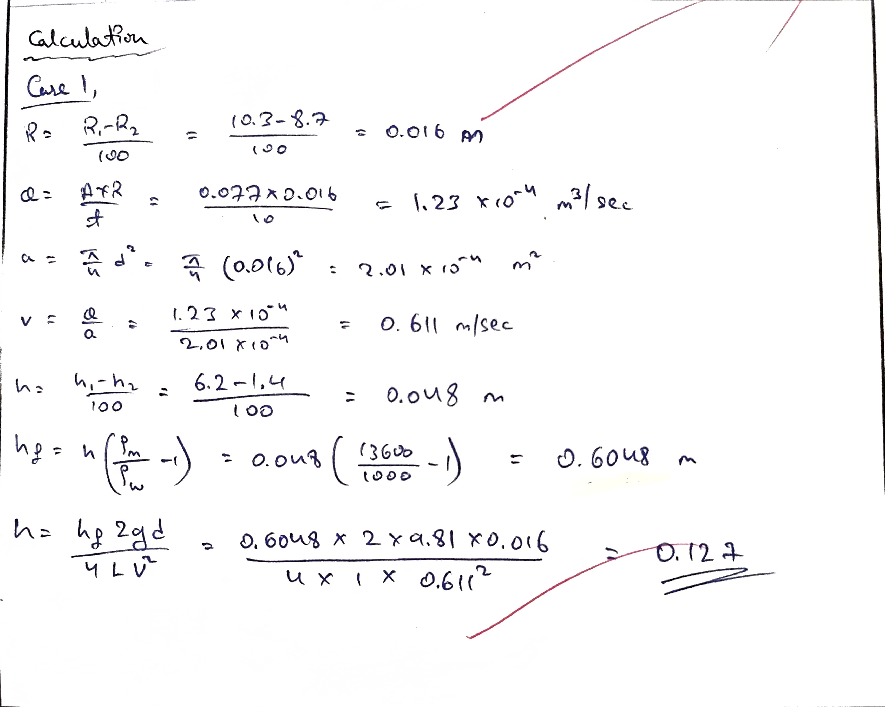
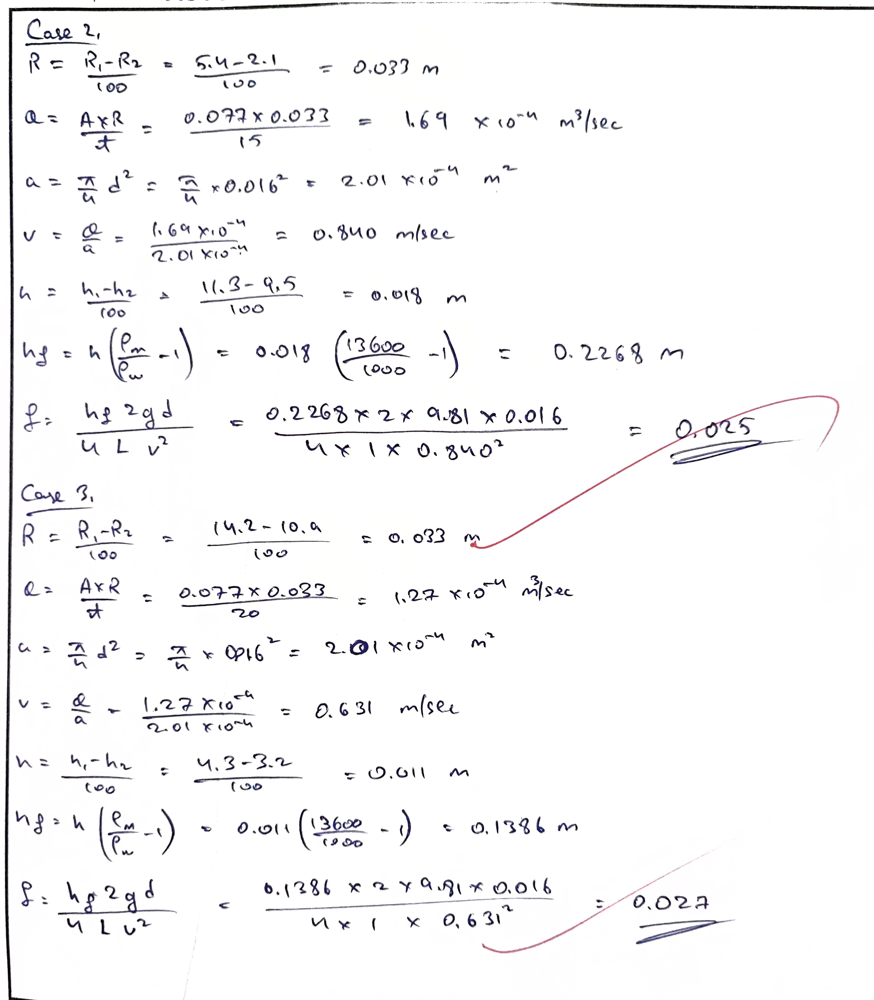
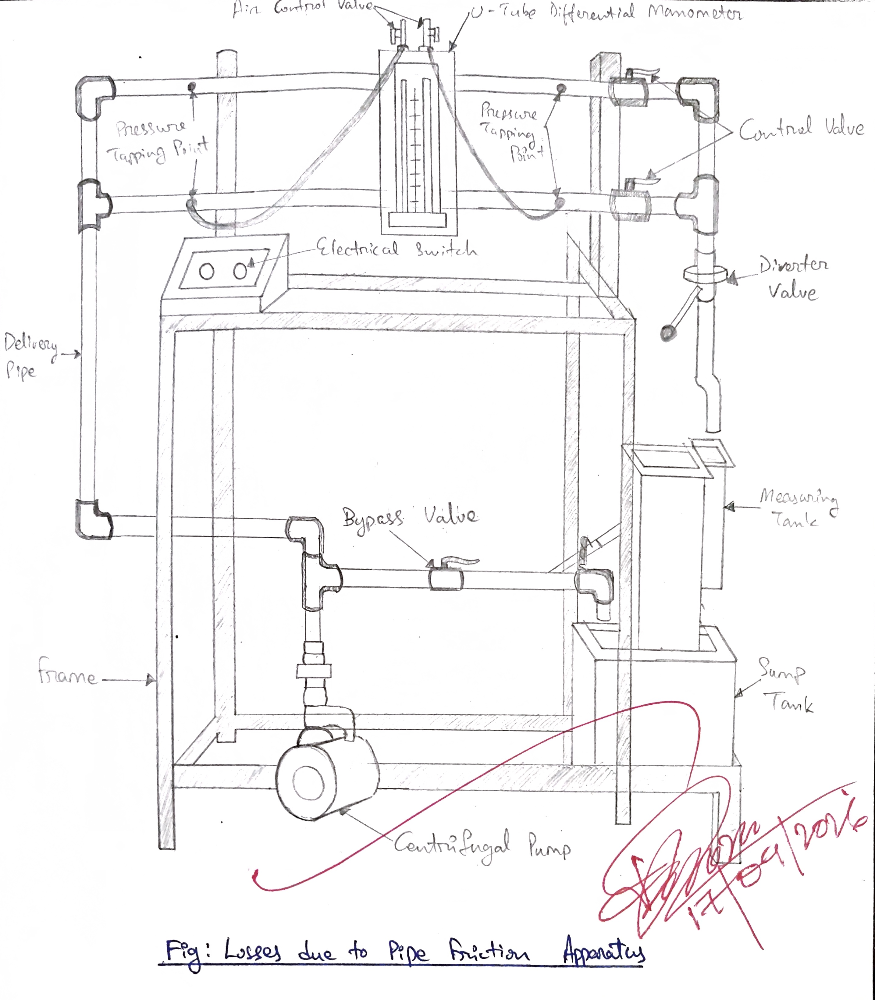

- **Experiment no.:** 03 
- **Title:** Losses due to pipe friction 
- **Objective:** TO study the losses due to friction in pipes. 
 **Aim:** To determine the friction factor for Darcy-Weisback Equation 

## Introduction 
When a fluid is flowing through a pipe, the fluid experiences some resistance due to which some of the energy of fluid is lost. This loss of energy in the pipelines comes under major energy losses and minor energy losses. In long pipeline the friction losses are much larger than the minor losses and hence the latteer are ofent neglected. THe loss due to friction in pipelines are known as major energy losses. The friction in pipeline are due to the viscous drag between the stream bands of fluid. THe stream bands of adjacent to the solid surface are always at rest relative to the wetted surface. The viscous drag is due to the molecular attraction between the molecule of the fluid. 

## Theory 
It is found that the total friction resistance of fluid flow depends on the following: 

1. The area of the wetted surface 
2. The density of the fluid 
3. The surface roughness 
4. It is independent of the fluid pressure
5. It increases with the square tof the velocity. 

THe loss of head in pipe due to friction is calculated from Darcy-Weisback equation which has been given by: 

$h_f = \frac{4fLV^2}{2gd}$

$h_f$ = loss of head due to friction  
f = friction factor  
L = distance between pressure point  
V = mean velocity of fluid  
d = diameter of pipe  
g = acceleration due to gravity 

## Descripiton 
The apparatus consists of sump tank with centrifugal pump. Two pipes of different diameter for which common inlet connection is provided with control valve to regulate the flow, near the down stream end of the pipe. Pressure taping are taken at suitable distance apart between which a manometer is provided to study the pressure loss due to the friction. Discharge is measured with th ehelp of measusring tank and stopwatch. 

## Experimental Procedure 
### Starting Procedure 
1. Firstly we close all the valves provided. 
2. Then we fill the sump tank 3/4 with clean water and ensure that no foreign particls are there. 
3. Then open the bypass valve. 
4. Ensure all pressure taps of manometer are closed. 
5. We ensure that the ON/OFF switch of the terminal/panel is at OFF position. 
6. Then we switch ON the main power supply. 
7. Then the pump is switched ON. 
8. We control the flow control valve and bypass valve to regulate the flow of water in the desired test section. 
9. The pressure taps of manometer are opened for required test section very slowly to avoid the flow of water on manometry fluid. 
10. Then we open the air release valve provided in the manometer slowly to release the air in manometer. 
11. When there is no air in the manometer, we close the air release valve. 
12. We adjust the water flow rate in desired section with the help of control valve. 
13. Then we record the manometer reading. 
14. We measure the flow of water discharged through desired test section using stopwatch and measuring tank. 
15. The same procedure is repeated for different flow rates of water by operating control valve and bypass valve. 
16. When experiment is over for one desired test section, open the bypass valve fully. Then close the flow of water using flow control valve of running test section and open the control valve of secondly desired test section. 
17. We repeat the same procedure for the test section. 

### Closing Procedure 
1. When experiment is over, close all manometer pressure tap first. 
2. Switch OFF pump. 
3. Switch OFF power supply to panel. 
4. Drain the tanks with the help of given drain valves. 

## Observation and Calculation 
Data: 

- A = 0.077 $m^2$
- $\rho_m = 13600 kg/m^3$
- d = 0.016 m (for pipe 1/2")
- L = 1 m (for pipe 1/2")
- g = 9.81 $m/sec^2$
- $\rho_w = 1000 kg/m^3$ 

### Observation Table 
| S. No. | $h_1$ cm | $h_2$ cm | $R_1$ cm | $R_2$ cm | t sec | 
|:-:|:-:|:-:|:-:|:-:|:-:|
| 1 | 6.2 | 1.4 | 10.3 | 8.7 | 10 | 
| 2 | 5.4 | 2.1 | 11.3 | 9.5 | 15 | 
| 3 | 4.3 | 3.2 | 14.2 | 10.9 | 20 | 

### Calculation 

