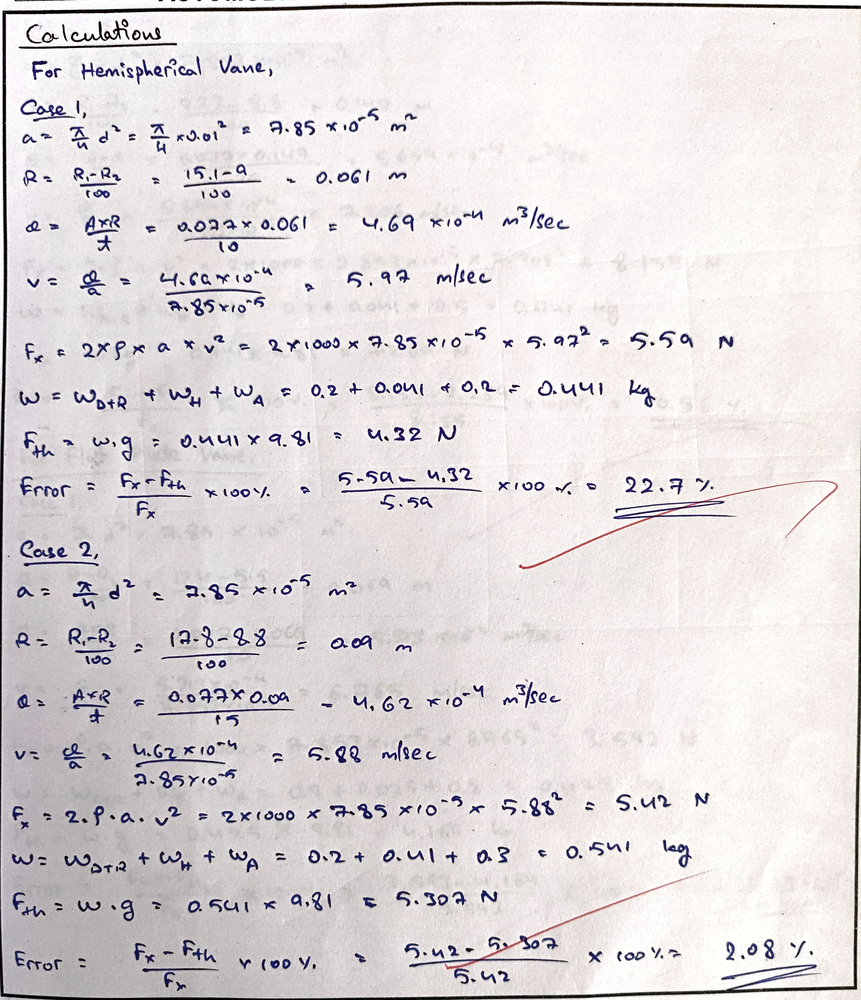
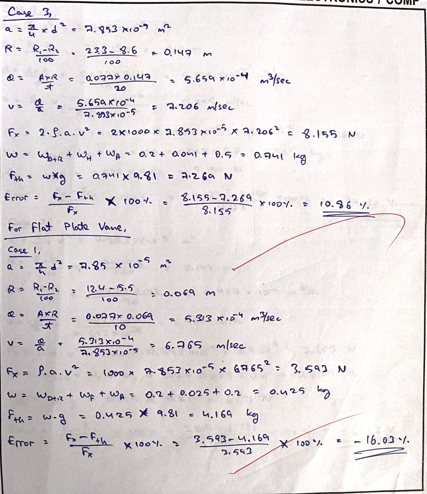
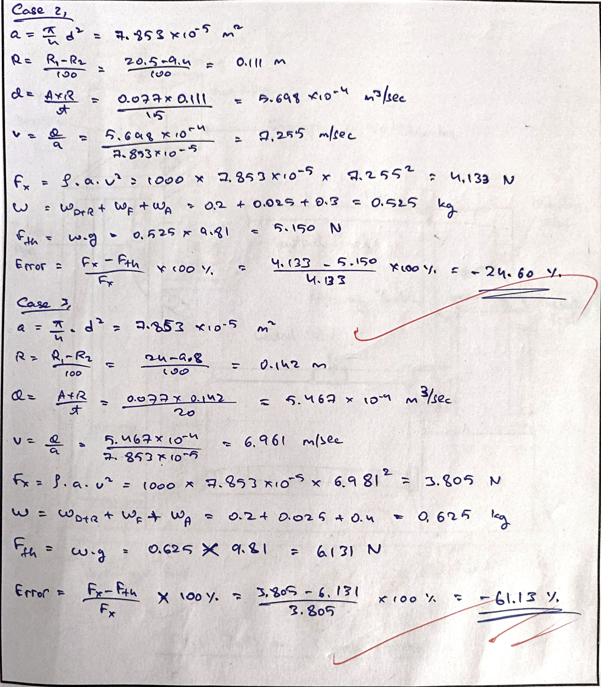
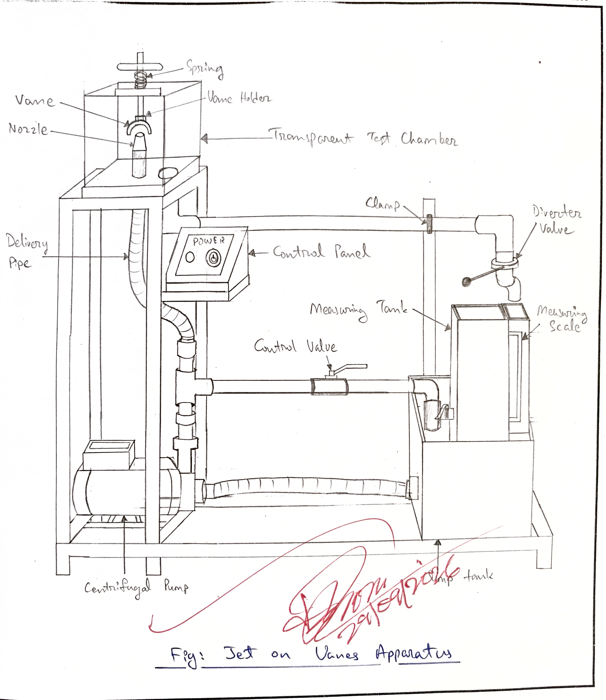

- **Experiment no.:** 04
- **Title:** Impact of Jet on Vanes 
- **Objective:** Study of Hydraulic Forces 
- **Aim:** To study the effect of force on following types of vanes 
    1. Hemispherical vane 
    2. Flat Plate Vane 

## Introduction 
When a plate is placed in the path of a jet, the jet exerts a forcce on the plate. This force can be calculated from the impulse-momentum equation. Momentum equation is based on Newton's second law of motion, which states that "the algebraic sum of external forces applied to control volume of fluid in any direction is equal to the rate of change of momentum in that direction." The external forces include the components of the weight of the fluid and the forces exerted externally upon othe boundary surface of the control volume. 

## Theory 
IF a vertical water ject moving with velocity 'v' is made to strike a target, which is free to move in the vertical direction, then a forces will be exerted on the ject by the impact of the jet. According to momentum equation, this forces (which is also equal to the force required to bring back the target in its original position) must be equal to the rate of change of momentum ofo the ject flow in the same direction.  
Due to impact of the jlect stationary vane, the entire velocity of the ject is destroyed and due to the rate of change of momentum force acts on the plate. THe jet after striking will move along the plate but the plate is at right angles too the jet. Hence the components of the velocity of the ject in the direction of the jet after striking it will be zero. THe force exerted by the jet on the flat plate in the direction of the jet. 

$F_x = \text{Rate of change of momentum of the direction of force}$  
$\implies \frac{\text{Initial momentum - Final Momentum}}{Time}$  
$\implies \frac{\text{Mass} \times \text{Initial velocity} - \text{Mass} \times \text{Final Velocity}}{\text{Time}}$  
$\implies \frac{\text{Mass}}{\text{Time}} \times \text{Initial velocity - Final Velocity}$  
$\implies \rho A V^2$ (for flat plate vane)  

For hemispherical vane,  
$F_x = 2\rho A V^2$

## Description
This setup consists of a sump tank with centrifugal pump to circulate water. A chamber with two side glass is provided for visualization of impact of jet on vanes. Water from sump tank flows throrugh a nozzle and strikes vertically on vane positiooned above the nozzle. Two types of vanes (hemispherical and flat) are provided that can be fixed one at a time. Arrangement is made for the movement of the plate of the vane under the action of the jet and also because of the weight placed on the loading pan. Measuring tank and stop watch is provided for flow measurement. 

## Experimental Procedure 
### Starting Procedure 
1. Firstly ensure that all the valves provided are closed. 
2. The sump tank is filled with water, ensuring no foreign particles are present. 
3. Then we fix the desired vane (hemispherical/flat) is fixed in place. 
4. We ensure that all ON/OFF switches on the panel are in OFF position. 
5. Then we open the bypass valve. 
6. Then the pump is switched ON. 
7. We have to put the desired weight on the pan. 
8. Then we control the flow of water through the channel by operating the bypass valve and flow control valve. 
9. The flow of water is controlled so that the applied weight on the top is counter balanced by the impactc of the ject. 
10. We measure the flow rate using a measuring tank and stopwatch. 
11. The experiment is repeated for differenet weights. 
12. Then the experiment is repeated for the other vane. 

### Closing Procedure 
1. When the experiment is over, the pump is switched off. 
2. The power supply to the panel is switched off. 
3. Water is drained from all the tanks using drain valves. 

## Observation and Calculation 
Data: 

- g = 9.81 $m/sec^2$
- d = 0.01 m 
- A = 0.077 $m^2$
- P = 1000 $kg/m^3$
- $W_{D+R} = 2 kg$
- $W_F$ = 0.025 kg 
- $W_H$ = 0.041 kg 

For hemispherical vane, 

| S. No. | $W_A$ kg | $R_1$ cm | $R_2$ cm | t cm | 
|:-:|:-:|:-:|:-:|:-:|
| 1 | 0.2 | 15.1 | 9 | 10 | 
| 2 | 0.3 | 17.8 | 8.8 | 15 | 
| 3 | 0.5 | 23.5 | 8.6 | 20 | 

For Flat Plate Vane, 

| S. No. | $W_A$ kg | $R_1$ cm | $R_2$ cm | t cm | 
|:-:|:-:|:-:|:-:|:-:|
| 1 | 0.2 | 12.4 | 5.5 | 10 | 
| 2 | 0.3 | 20.5 | 9.4 | 15 | 
| 3 | 0.4 | 24 | 9.8 | 20 | 

## Calculations 

