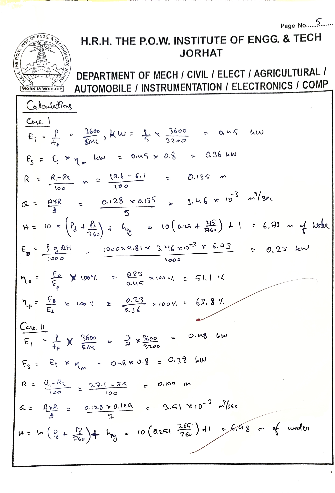
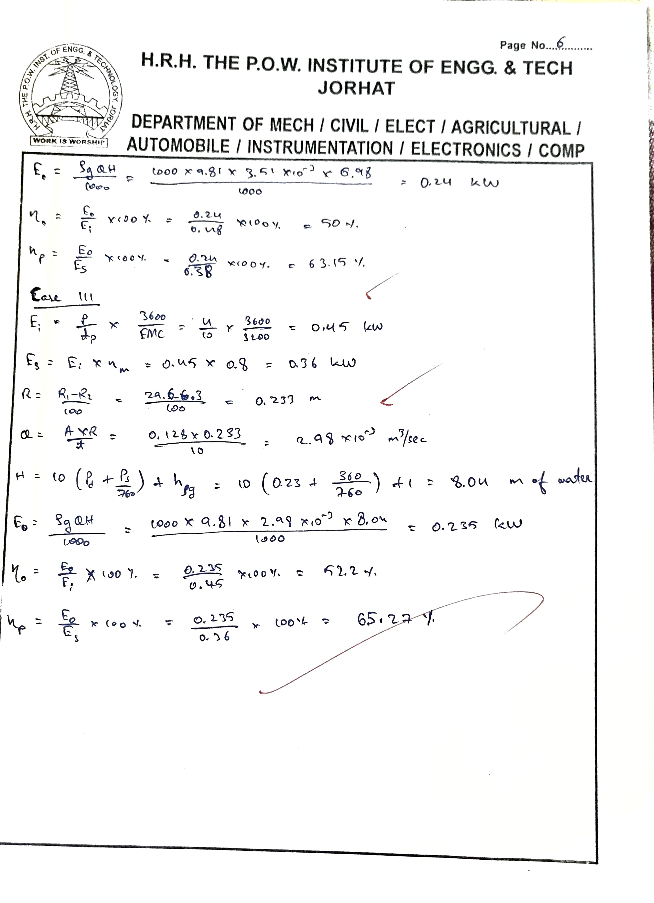
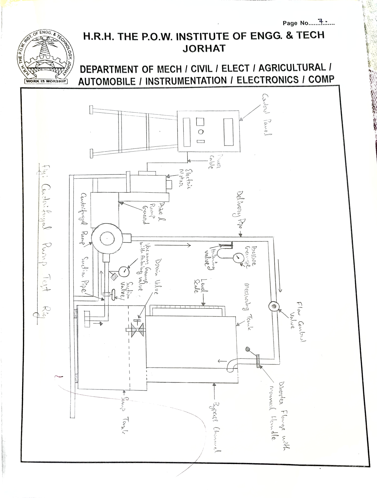
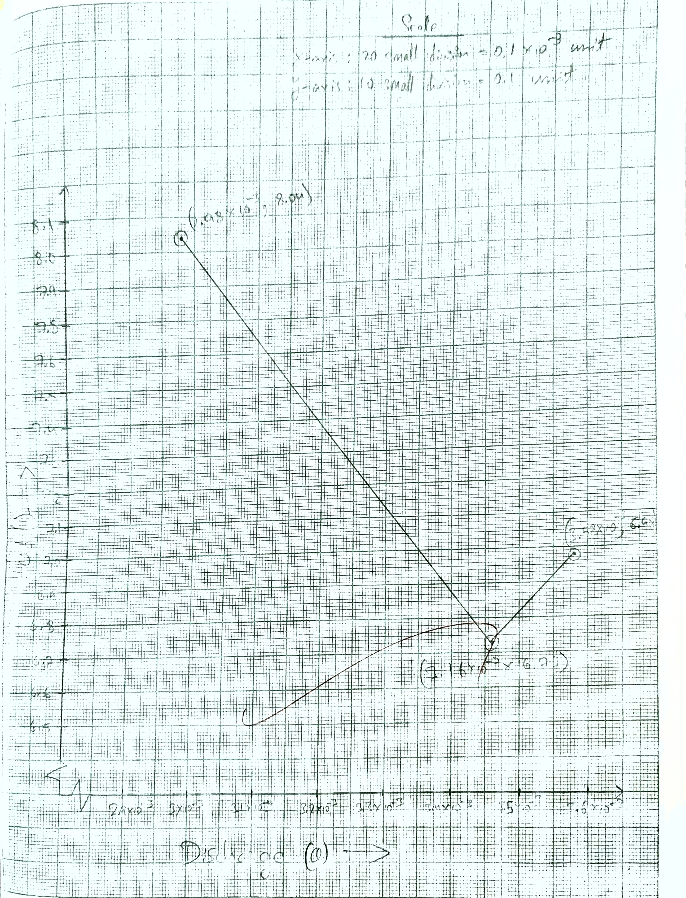
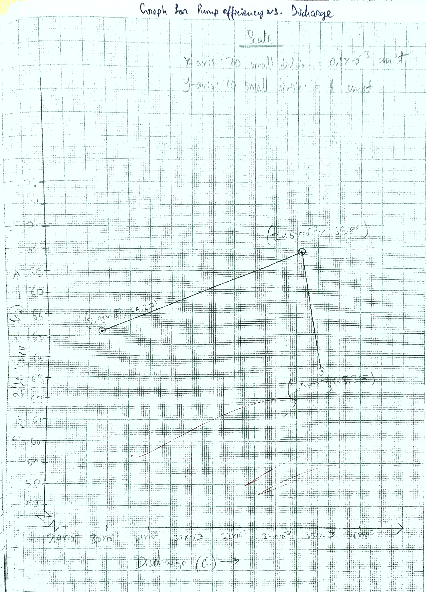

- **Experiment no.:** 05
- **Title:** Centrifugal Pump Test Rig (With AC motor, speed with step cone pulley)
- **Objective:** Study the centrifugal pump characteristics 

## Aim
- To determine: 
    - Power input 
    - Shaft Output 
    - Discharge 
    - Total Head 
    - Pump Output 
    - Overall Efficiency 
    - Pump Efficiency 

To plot the following performance characteristics:  
Head and Discharge  
Pump Efficiency and Discharge 

## Introduction 
The hydraulic machines which convert the mechanical energy into hydraulic energy are called pumps. The hydraulic energy is in the form of pressure energy. If the mechanical energy is converted into pressure energy by means of centrifugal force acting on the fluid, the hydrarulic machine is called centrifugal pump. 

## Theory 
The centrifugal pump acts as a reversed of an inward radial flow reaction turbine. This means that the flow in centrifugal pump is in the radial outward directions. The centrifugal pump works on the principle of forced vortex flow, which means that when an external torque rotates a certain mass of liquid, the rise in pressure head of the rotating liquid takes place. The rise in pressure head at any point of the rotating liquid is proportional to the square of tangential velocity (i.e., rise in pressure head is $V^2/2g$ or $\omega^%2r^2/2g$) of the liquid at that point. Thus, the outlet of the impeller which radius is more, the rise in pressure haed will be more andh the liquid will be discharged at the outlet with a high pressure head. Due to this high pressure head, the liquid can be lifted to a high level.  
Centrifugal pump is a mechanical device, which consists of a body, impeller and a rotating mean, i.e., motor, engine, etc. IMpeller rotates in a stationary body, sucks the fluid through its axes, and deliver its periphery. Impeller has an inlet angle, outlet tangle and peripheral speed, which affects the head and discharge. Impeller is rotated by motor, engine or any other device. 

## Description 
Centrifugal Pump Test Rig consists of a sump, a centrifugal pump, an AC motor and measuring tank. To measure the head, pressure and vacuum gauges aree provided. To measure the discharge, a measuring tank is provided. Flow diversion system is provided to divert flow from sump tank to measuring tank and from measuring tank to sump tank. A vavlve is provided in pipeline to change the rate of flow. 

## Experimental Procedure
### Starting Procedure
1. Ensure the apparatus is clean and the tank is free from dust.
2. Then the drain valve is closed.
3. The sump tank is filled with clean water, ensuring that no foreign particles are present.
4. Open the flow control valve on the water discharge line and the control valve on the suction line.
5. Then, with the pump in the off position, ensure that all ON/OFF switches on the panel are at the pulley arrangement.
6. Set the desired speed of the pump with the help of the step cone.
7. Operate the flow control valve to regulate the flow of water discharged by the pump.
8. Operate the control valve to regulate the suction of the pump.
9. Then record the discharge pressure by means of the pressure gauge provided on the discharge line.
10. The suction pressure is recorded by means of the vacuum gauge provided at the suction of the pump.
11. Record the power consumption by means of the energy meter provided in the panel.
12. Then measure the flow of water discharged by the pump using a stopwatch and measuring tank.
13. Repeat the same procedure at different time intervals.

### Closing Procedure 
1. When the experiment is over, open gate valve properly provided on the dischargee line. 
2. Then reduce the RPM of the pump with the help of DC drive. 
3. Switch OFF the pump first. 
4. Then switch off power supply. 

## Observation and Calculation 
### Data 
- EMC: 3200 pulses/kW hr 
- A = 0.128 $m^2$
- $\rho$ = 1000 $kg/m^3$ 
- $\eta_m = 0.8$ (assumed)
- g = 9.81 $m/s^2$ 
- $\eta_{\rho g} = 1\ m$

| S. no. | N rpm | $P_d\ kg/cm^2$ | $P_s\ \text{mmHg}$ | $R_1$ cm | $R_2$ cm | $t$ sec | $t_p$ sec | No. of pulses | 
|:-:|:-:|:-:|:-:|:-:|:-:|:-:|:-:|:-:|
| 1 | 2900 | 0.29 | 215 | 19.6 | 6.1 | 5 | 5 | 2 | 
| 2 | 2900 | 0.25 | 265 | 27.1 | 7.9 | 7 | 7 | 3 | 
| 3 | 2900 | 0.23 | 360 | 29.6 | 6.3 | 10 | 10 | 4 | 

