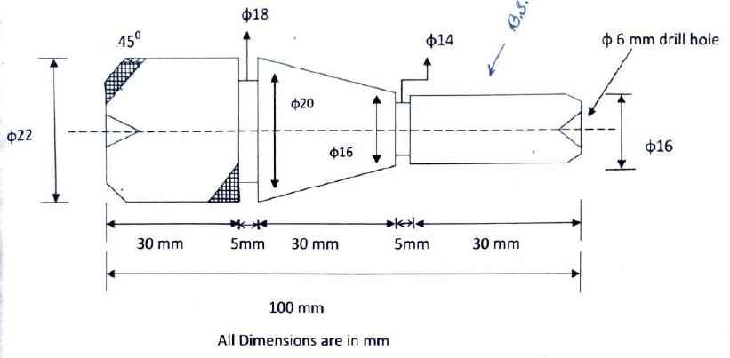
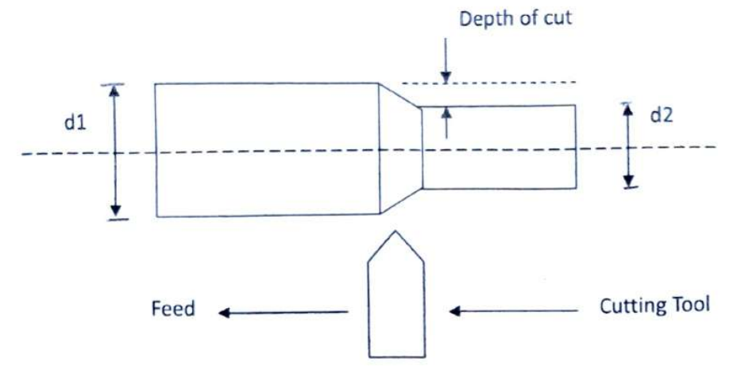
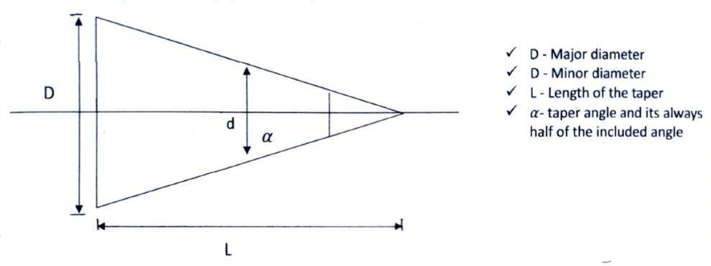
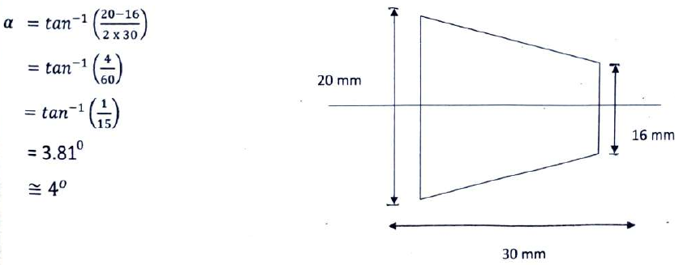

# Title Card
- Laboratory: MT Lab
- Title of the Job: Taper Mandrel
- Date of Commencement: 20/08/2026
- Date of Submission:

# Job Card
## Sketch of Job with Particulars

## Materials Required for the Job
1. M/S round bar: 1 no.

## Tools and Equipment Required for the Job
1. Hacksaw
2. Table vice
3. Grinding machine
4. Steel foot rule
5. Marking tool
6. Vernier caliper
7. V-shaped cutter
8. Outside caliper
9. Surface gauge
10. Straight shank twist drill
11. Square grooving tool
12. Knurling tool
13. Adjustable wrench

## Sequence of the Job
1. Measuring
2. Marking
3. Cutting
4. Holding
5. Facing
6. Drilling
7. Plain turning
8. Step turning
9. Taper turning
10. Grooving
11. Thread cutting
12. Knurling
13. Chamfering
14. Parting off

## Diary
| Description of works performed                                                                                                       |    Date    |  Time   |
| ------------------------------------------------------------------------------------------------------------------------------------ | :--------: | :-----: |
| 1. Measured an M/S bar (round) for lathe operation, cut it to the appropriate length, and then started the facing operation.         | 20/08/2026 | 3 hours |
| 2. Operated the lathe machine and completed facing.                                                                                  | 28/08/2026 | 3 hours |
| 3. Started plain turning on the job and completed half of the length.                                                                | 07/09/2026 | 3 hours |
| 4. Operated the all-geared lathe and performed drilling, square grooving, knurling, taper turning and chamfering on one side.        | 15/09/2026 | 3 hours |

> [!NOTE]
> - Given dimension: 100x25x25 mm 
> - Check-up dimension: 100x22x22 mm

# Journal
## Transmission of Power and Motion
### Introduction
A source of power is always needed in various works or processes, particularly in cutting and forming metal into shape using a machine tool. Electricity as a means of conveying power to machinery is now widely adopted. The power is nearly always supplied to the machine in the form of rotational energy. Electrical energy is converted into rotational energy by an electric motor, and the machine converts the input rotational energy into the various forms necessary for doing a job.

## System of Drive
Generally, two systems are used to drive a machine:

1. Group drive (one motor drives more than one machine)
2. Individual drive (one motor drives one machine)

Speed variation: hard metals need low speed and soft metals need high speed.

## Power or Motion Transmitting Elements
1. Rope
2. Belt
3. Chain
4. Friction
5. Clutches
6. Rack and pinion

## Machine Shop
A machine shop is a place where metal parts are cut to the required shape and assembled to form a mechanical unit. Machines are made to meet the needs of modern civilization. In a machine shop, we can generally produce round jobs.

## Types of Tools
1. **Measuring tools:** Tools used for measuring are known as measuring tools. There are two types:
    1. Direct measuring tools: vernier caliper, micrometer, screw gauge, etc.
    2. Indirect measuring tools: outside caliper, odd-leg caliper, inside caliper, divider, etc.

2. **Cutting tools:** Tools that can cut metal and are made of hardened and tempered steel. They are of two types:
    1. Single-point cutting tools: chisels, V-shaped cutter, square grooving tool, boring tool, etc.
    2. Multi-point cutting tools: saw blade, knurling tool, drill bit, reamer, tap and die, etc.

## Cutting Tool Material
1. High Carbon Steel (H.C.S.)
2. High Speed Steel (H.S.S.; Tungsten [18] : Chromium [4] : Vanadium [1])
3. Cemented carbide
4. Ceramics
5. Abrasives
6. Stellites
7. Diamond
8. Cubic boron nitride

## Machine Tools
Tools that remove excess metal from the workpiece with the help of a cutting tool to give the desired shape to the workpiece are known as machine tools. Examples: lathe, milling, grinding, drilling, shaper, planer, slotter, power saw, etc.

## Lathe
A lathe is a metal-turning machine tool in which the work, while revolving on a horizontal axis, is acted upon by a cutting tool. The tool is made to feed slowly in a direction more or less parallel to the axis of the work (longitudinal feed), at right angles to the axis of the work (cross feed), or at any angle to the axis of the work (angular feed).

The lathe can perform various types of operations, such as facing, drilling, plain turning, step turning, taper turning, square grooving, knurling, boring, reaming, polishing, undercutting, countersinking, external and internal thread cutting, and chamfering. The lathe can also perform gear cutting by using special attachments.

## Principle of Lathe
The main principle of the lathe is that the job revolves on a horizontal axis and the metal is cut with the help of a cutting tool to give the desired shape and size to the workpiece.

## Function of Lathe
The main function of the lathe is to remove excess metal from the workpiece with the help of a cutting tool to give the desired shape and size to the workpiece.

## Depth of Cut
The perpendicular distance measured from the uncut surface to the cut surface is known as the depth of cut on the lathe machine.

$$
\text{Depth of Cut, } D = \frac{\text{uncut surface - cut surface}}{2}
\\
\text{OR, } D = \frac{d_1 - d_2}{2}
$$

## Size and Specification of Lathe
1. Length of the bed
2. Width of the bed
3. Distance between two centres
4. Height of centre measured from the lathe bed
5. Swing diameter over the bed
6. Swing diameter over the carriage
7. Maximum spindle diameter

### Types of Lathe
1. Centre lathe
    1. Belt-driven
    2. Gear-driven
    3. Individual motor-driven
2. Bench lathe
3. Turret lathe
4. Capstan lathe
5. Speed lathe
    1. Woodworking
    2. Spinning
    3. Polishing
    4. Centering
6. Special-purpose lathe
    1. Gap lathe
    2. Wheel lathe
    3. Tee lathe
    4. Duplicating lathe
7. Automatic lathe (e.g., CNC)

## Parts of Lathe
1. Bed
2. Headstock
3. Tailstock
4. Carriage
5. Lead screw
6. Rack

### Bed
The bed is the main part of the lathe machine, on which the headstock, tailstock and carriage are located. There are three types of bed: V-bed, gap bed and flat bed.
Beds are generally made from grey cast iron with nickel and chromium.

### Headstock
The headstock is located on the left-hand side of the bed. Its main function is to give the desired speed to the workpiece with the help of the spindle. There are three types of headstock: (a) belt-driven, (b) gear-driven and (c) individual motor-driven.

The belt-driven headstock consists of the following parts:

1. Spindle
2. Bearing
3. Gear or pinion
4. Step cone pulley
5. Bull gear
6. Back gear unit
7. Bull gear lock nut
8. Reversible or tumbler gear, etc.

### Tailstock
The tailstock is located on the right-hand side of the bed. Its main functions are:

- It acts as a supporting agent when machining a long job or a job between centres (live and dead).
- It can perform drilling, reaming and tapping.
- It can perform taper turning.

The tailstock consists of the following parts:

1. Dead centre
2. Spindle
3. Base
4. Hand wheel
5. Spindle lock nut
6. Clamping bolt
7. Off-setting nut

### Carriage
The main function of the carriage is to move and control the cutting tool. The carriage consists of two main parts:

1. Apron
2. Saddle, which has three parts:
    1. Cross slide
    2. Compound slide (for angular movement)
    3. Tool post

### Tool Post
The tool post is used to hold or mount the cutting tool. It is of four types:

1. One-way or one-bolt tool post
2. Two-way or four-bolt tool post
3. Four-way or eight-bolt tool post
4. Open-mouth tool post

### Lead Screw
The lead screw is a long threaded shaft used as a master shaft. Its main function is to give automatic feed to the carriage by engaging the half-nut lever during the thread-cutting operation. The lead screw thread is always an Acme thread, and the thread angle is 29°.

### Rack
The main function of the rack is to give easy movement to the carriage. It is always fitted under the bed.

### Lathe Accessories
These are used for either holding or supporting the workpiece. There are various types of accessories:

1. Chuck
2. Dogs or carrier
3. Face plate
4. Mandrel
5. Steady rest
6. Follower rest
7. Driving plate

### Lathe Attachment
Attachments are used for special operations under special conditions. Examples: taper turning attachment, milling attachment, grinding attachment, etc.

### Chuck
The main function of the chuck is to hold the workpiece. There are various types of chuck:

1. 3-jaw self-centering chuck
2. 4-jaw independent chuck
3. Collet chuck
4. Drill chuck
5. Air or hydraulic chuck
6. Magnetic chuck

#### Difference between 3-Jaw and 4-Jaw Chuck
| 3-Jaw Self-Centering Chuck | 4-Jaw Independent Chuck |
|-|-|
| The jaws move simultaneously | The jaws move independently |
| We cannot get a proper centre | We can get a proper centre |
| We cannot properly hold any job other than a round one | We can hold both round and irregular jobs |

## Taper Turning
A taper may be defined as a cone-shaped form in which the diameter gradually decreases from one end of the workpiece to the other. The operation is known as taper turning.

There are various methods of taper turning:

1. By broad-nose tool
2. By swivelling the compound slide/rest
3. By tailstock offset method
4. By taper turning attachment
5. By giving compound feed (longitudinal and cross feed)

### Calculation of Swivelling of Compound Slide Method

$$
\alpha = \tan^{-1} \left(\frac{\text{major diameter - minor diameter}}{2 \times \text{length of taper}}\right)
\\
\alpha = \tan^{-1} \left(\frac{D-d}{2L}\right)
$$

## Thread Cutting
The cutting tool should be ground to the proper angle of the required thread. Use the tumbler gear (reversing gear) to cut left-hand and right-hand threads. After calculating the gear ratio, set the driven gear in its proper position on the stud, and chalk-mark the screw thread. Cutting should be slow, with the back gear engaged with the spindle gear and the bull gear lock pin disengaged.

### Thread Cutting Process
In the English system,

$\implies \frac{\text{Lead screw threads per inch}}{\text{Threads per inch to be cut}} = \frac{\text{Driver}}{\text{Driven}}$

$\implies \frac{\text{Pitch of the workpiece to be cut}}{\text{Pitch of the lead screw}} = \frac{\text{Driver}}{\text{Driven}}$

- Lead screw threads per inch = 8
- Threads per inch to be cut = 11 (from thread list)
- Our machine has a gear range of 4

$\frac{8}{11} = \frac{DR}{DV}$

$\frac{DR}{DV} = \frac{8 \times 4}{11 \times 4} = \frac{32}{44}$

The driver has 32 teeth and the driven gear has 44 teeth. These two gears are not sufficient; another gear, known as an idler gear, is required. It can have any number of teeth.
